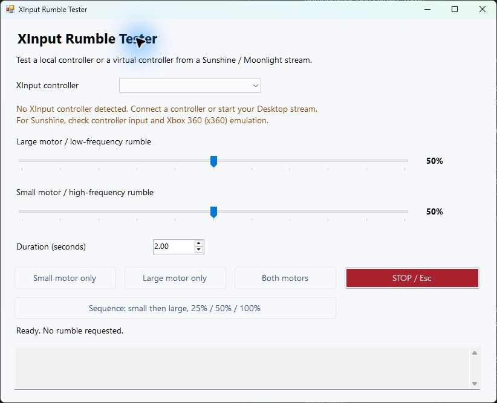

# XInput Rumble Tester

A small Windows utility for testing the two rumble motors of an XInput controller without launching a game. Use it with a controller connected directly to your PC, or with the virtual controller created by Sunshine while streaming to Moonlight.

[Download the latest release](https://github.com/AntonisKoutsouras/xinput-rumble-tester/releases/latest)



## What it does

- Independent **large / low-frequency** and **small / high-frequency** motor controls, from 0% to 100%.
- Small-only, large-only and combined pulses, with a requested duration of 0.25–10 seconds.
- A preset sequence: small motor at 25%, 50%, 100%, then large motor at the same levels. Each pulse lasts two seconds, with a one-second stop between pulses.
- **STOP** button and **Esc** cancel the running pulse or sequence.
- Controller selection and live button/packet indicators to help identify the correct XInput slot.
- Local logs of requested effects and XInput results.

The app does not send rumble on launch or controller detection. Changing a slider only changes the next requested effect. A new test replaces the current test; normal completion and app closure send zero to both motors.

## Requirements and scope

- Windows 10 or 11 with .NET Framework 4.8. No installer, administrator privileges or extra application libraries are required.
- A controller exposed to Windows through **XInput**, with a driver/backend that supports rumble.
- For remote tests, an active Sunshine/Moonlight streaming session with controller input enabled.

USB, a wireless dongle or Bluetooth can work for a local controller **if its Windows driver exposes XInput**. DirectInput-only/HID-only devices and native PlayStation controller interfaces are not supported by this tool. It does not add rumble support to unsupported drivers, clients or controllers, and does not send vendor-specific Bluetooth commands.

This tool uses the two main XInput rumble channels. It does not test trigger motors, adaptive triggers, HD rumble or advanced haptics. XInput exposes up to four slots; it does not provide friendly device names here.

## Run

Download `XInputRumbleTester.exe` from [Releases](https://github.com/AntonisKoutsouras/xinput-rumble-tester/releases/latest) and save it in a writable folder. Double-click it. Release binaries are not Authenticode-signed; a `SHA256SUMS.txt` file is provided alongside each binary.

### Controller connected directly to the PC

1. Connect the controller in an XInput-compatible mode.
2. Select its slot. A single detected controller is selected automatically; with multiple controllers, select the intended one.
3. Press a controller button and check that the button indicator changes.
4. Choose intensity and duration, then test **Small motor only**, **Large motor only**, or **Both motors**.
5. Check that the effect stops, then try the sequence if desired.

### Sunshine and Moonlight

Run the tester **on the Windows PC running Sunshine**.

1. Connect the physical controller to the Moonlight client device (TV, phone or another computer).
2. Start a **Desktop stream** from Moonlight. Pairing with the host alone does not create an active streamed controller.
3. Press a controller button and select the corresponding XInput slot in the tester on the host PC.
4. Run the individual motor tests, combined effect and STOP.

The path being exercised is:

```text
Tester on host PC -> XInput virtual controller -> Sunshine rumble feedback
                 -> Moonlight client -> physical controller
```

For a remote test, disconnect any local controller/dongle that could be mistaken for the streamed controller. If no XInput slot appears, first check that controller input reaches the host. In Sunshine, Xbox 360 (`x360`) emulation is an XInput-compatible choice. A PlayStation-style virtual controller will not appear in this tester unless another layer exposes it through XInput.

The client must implement rumble for the connected controller and transport. A successful host API call alone does not prove that the physical controller vibrated.

## How this relates to games

The app calls Windows `XInputSetState` with an `XINPUT_VIBRATION` structure. The large motor uses `wLeftMotorSpeed`; the small motor uses `wRightMotorSpeed`. Each requested percentage is mapped to an unsigned value from 0 to 65535.

This is the same API and motor representation used by XInput games. Games choose their own changing intensities and timing; not every game or Steam Input setup uses the same interface. Percentages are requested output values, not measurements of physical vibration strength.

References: [Microsoft XINPUT_VIBRATION](https://learn.microsoft.com/en-us/windows/win32/api/xinput/ns-xinput-xinput_vibration), [XInputSetState](https://learn.microsoft.com/en-us/windows/win32/api/xinput/nf-xinput-xinputsetstate), [Sunshine configuration](https://docs.lizardbyte.dev/projects/sunshine/master/md_docs_2configuration.html).

## Logs and troubleshooting

`rumble-tests.log` is written beside the executable when that folder is writable. It records timestamps, slot, requested percentages, duration and API results. The app makes no network requests and uploads no logs. An `XInput accepted` entry is explicitly separate from physical confirmation.

A read-only diagnostic is also available:

```powershell
.\XInputRumbleTester.exe --probe
```

It writes `xinput-probe.txt` beside the executable, enumerating all four slots without sending rumble. Result `0` means a connected slot; `1167` means no connected device in that slot. Run only one tester instance and avoid simultaneous rumble from a game, since those requests can replace one another.

## Build from source

The source is a small C# Windows Forms application. The build script uses the .NET Framework C# compiler already included with the framework; it restores no NuGet packages and downloads nothing.

```powershell
git clone https://github.com/AntonisKoutsouras/xinput-rumble-tester.git
cd xinput-rumble-tester
.\build.ps1
```

Output: `bin\XInputRumbleTester.exe` and `bin\SHA256SUMS.txt`. Open this folder in VS Code if you prefer editing there; no particular IDE is required.

## Validation and contributing

The original development build was manually tested with an **8BitDo Ultimate 2.4G, firmware 2.04, D-mode Bluetooth**, connected to a TCL TV running a Moonlight TCL build with support for that model. Through a Sunshine Desktop stream, both motors and STOP worked. The English release preserves that rumble-control logic; this result is not a claim of universal controller compatibility. The Moonlight support patch is separate from this repository.

See [the manual test checklist](docs/TESTING.md) for local and streamed tests. Contributions and reproducible controller reports are welcome. Include the controller model, connection mode, host/client software versions, selected slot and what you physically felt. Do not infer successful physical rumble solely from an API success log.

This is an independent tool, not an official Sunshine, Moonlight, Microsoft or 8BitDo product.

## License

[MIT](LICENSE).
